<picture>
  <source media="(prefers-color-scheme: dark)" srcset="assets/brand/voiney-lab_logo_white.svg">
  
</picture>

# 장갑을 낀 채 말로 진행하는 실험 안내

[](https://github.com/jaeiko/voiney-lab/actions/workflows/ci.yml)

**Voiney Lab**은 화학·바이오 연구자가 **자기 연구실의 프로토콜**을 따라 실험하도록 돕는 음성 가이드예요. 원문을 올리고, 필요한 값만 확인한 뒤, 말로 안내를 듣고 타이머와 기록을 남겨 실험 노트로 이어 가요.

**지금은 통제된 파일럿 준비 단계이며, 현장 검증 전이에요.** 개발 서버에서 사람이 말해 본 기록과 오프라인 시험이 있고, 실제 연구실에서의 성능은 아직 측정하지 않았어요. 회사 **Voiney**는 2026-10-27 사업자 등록을 마쳤어요. 제품·사용자·측정 근거는 [제품 맥락](.agent/product_context.md)에 있어요.

[화면으로 보기](#2-화면으로-보기) · [작동 방식](#4-작동-방식) · [개발용 실행](#5-개발용으로-실행하기) · [측정 결과](#7-측정한-것과-아직-모르는-것)

## 1. 연구자에게 어떤 도움이 되나요?

- **자기 원문에서 시작해요.** PDF·Word·사진이나 공개 Google Drive·Docs 링크를 올리고, 분석할 쪽을 골라요.
- **확인이 필요한 것만 물어요.** 분석과 원문 근거 검사 후, 확인하지 못한 부분을 카드 한 장씩 보여 줘요. 시작을 막는 문제가 없으면 연구자가 **이 프로토콜로 시작**을 눌러요.
- **실험 중에는 말로 이어 가요.** 지금 단계 안내, 원문의 시간으로 타이머, 질문·다시 듣기·관찰 기록을 지원해요. 한국어 단계와 타이머, 기록 칸을 태블릿·휴대폰에서 볼 수 있어요.
- **실제로 남긴 기록에서 노트를 만들어요.** 실험 노트와 Word·Markdown·JSON·CSV 내보내기를 지원하고, 확인하지 않은 값은 `[미확인]`으로 남겨요.

모델은 제안만 하고 서버가 실험 진행을 정해요. 값과 안전 주의는 원문이나 사람이 확인한 값에서만 가져와요. 관리자의 **확인함**은 기록이며 승인 단계가 아니에요.

ELN·LIMS를 대신하거나 장비를 제어하지 않아요. 자율 실험이나 GLP·GMP·임상·규정 준수를 주장하지 않아요. 절차 자체를 추가·삭제·재배열하는 탐색 실험은 [설계 단계](docs/ADAPTED_RUN_PLAN.md)예요.

## 2. 화면으로 보기

새 화면(`/app/`)을 실제 브라우저에서 걸으며 찍었어요. 가로 태블릿은 바이오 견본, 휴대폰은 화학·토양 분석 견본이에요. 아래 자료는 실험 방법이나 현장 검증 결과가 아니에요.

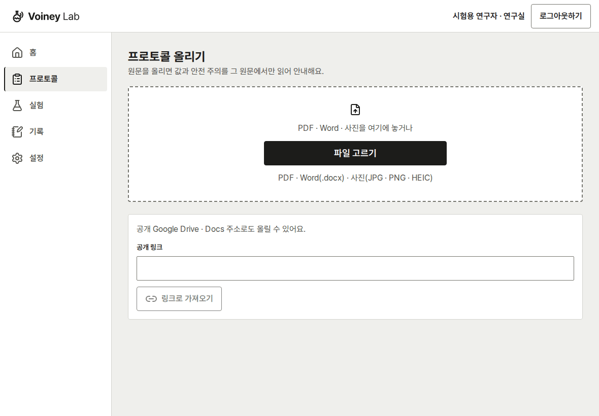

시험용 가짜 자료로 찍은 화면. 흐름을 요약한 무음 움직이는 그림이며 실제 음성 시연이 아니에요.

<details>
<summary>장면별 화면 펼치기 — 가로 태블릿 · 휴대폰</summary>

### 원문 올리기 · 분석할 쪽 고르기

| 가로 태블릿 · 바이오 견본 | 휴대폰 · 화학 견본 |
|---|---|
| 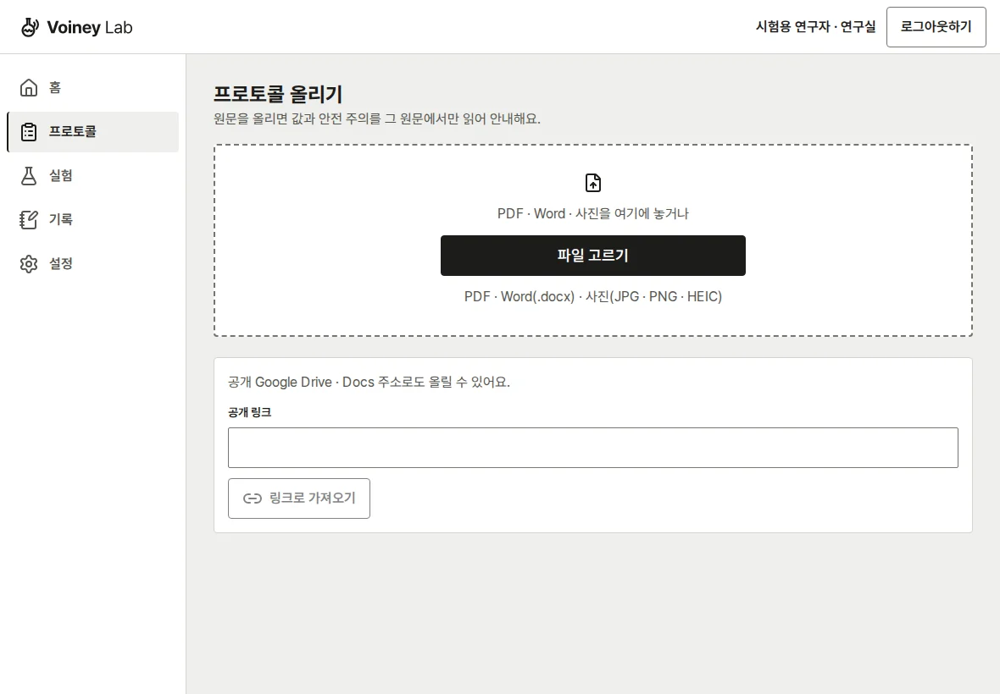 | 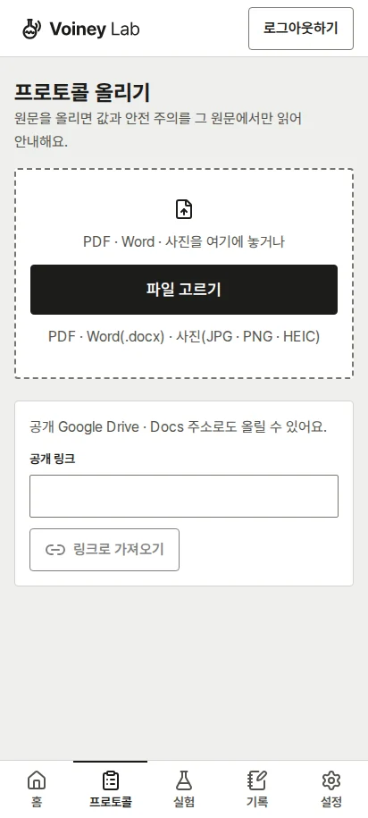 |
| 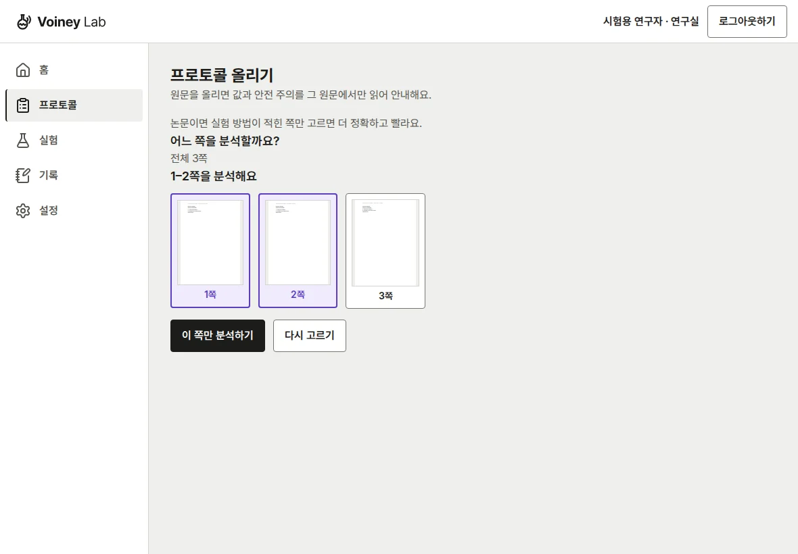 | 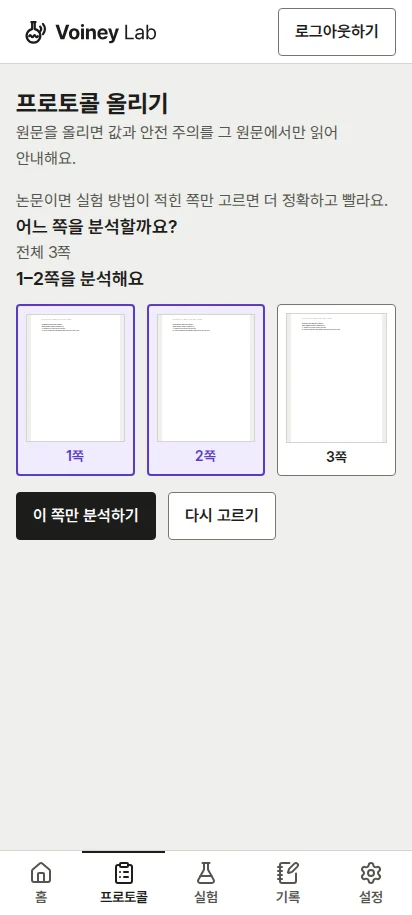 |

시험용 가짜 자료로 찍은 화면.

### 확인 카드 · 시작 전 핵심 값 확인

| 가로 태블릿 · 바이오 견본 | 휴대폰 · 화학 견본 |
|---|---|
| 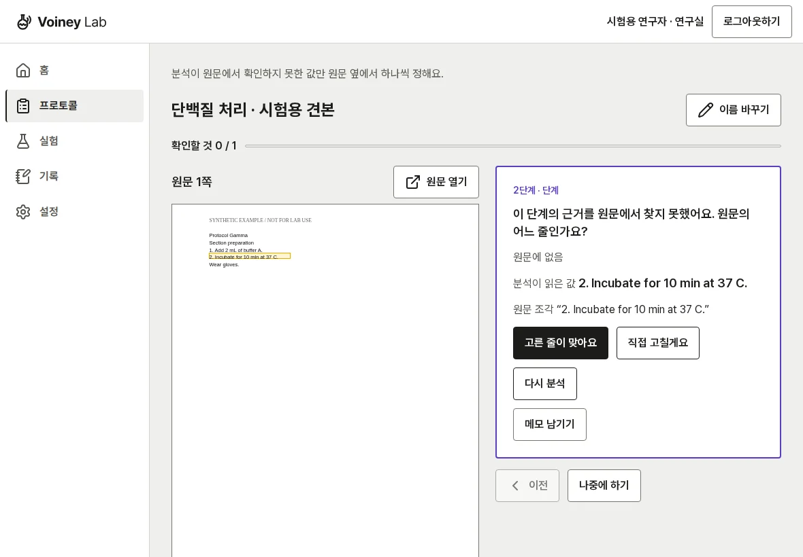 | 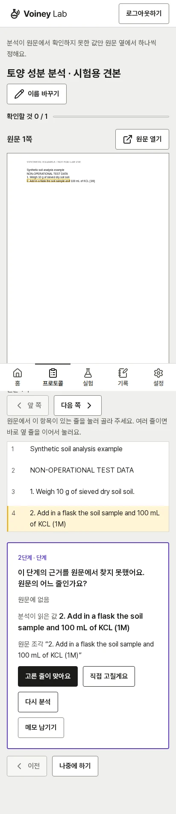 |
| 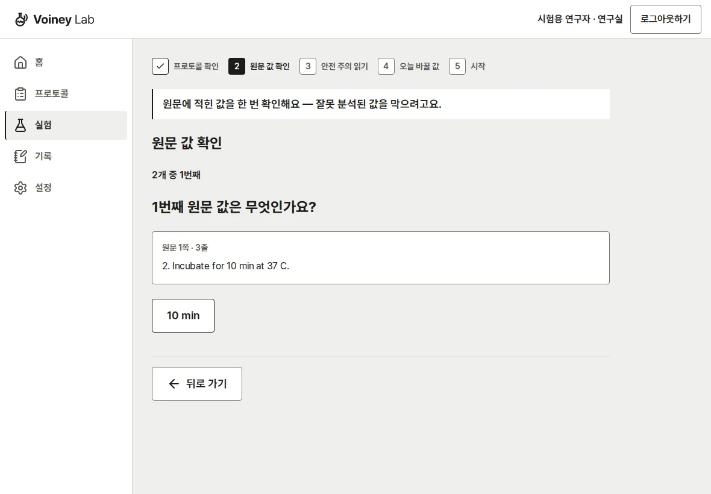 | 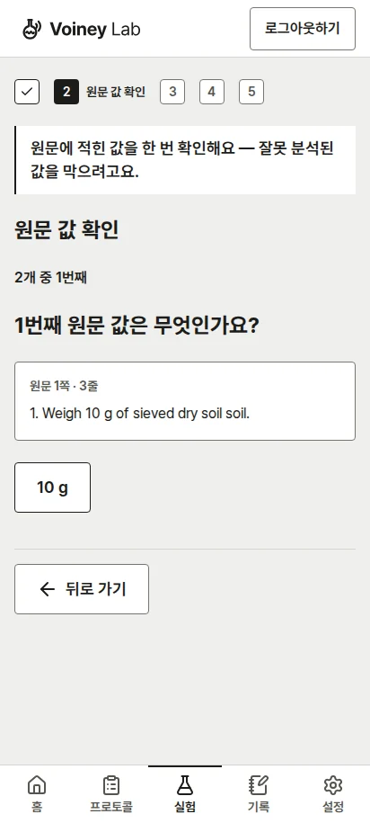 |

시험용 가짜 자료로 찍은 화면.

### 실험 화면 — 한국어 단계 · 타이머 · 기록

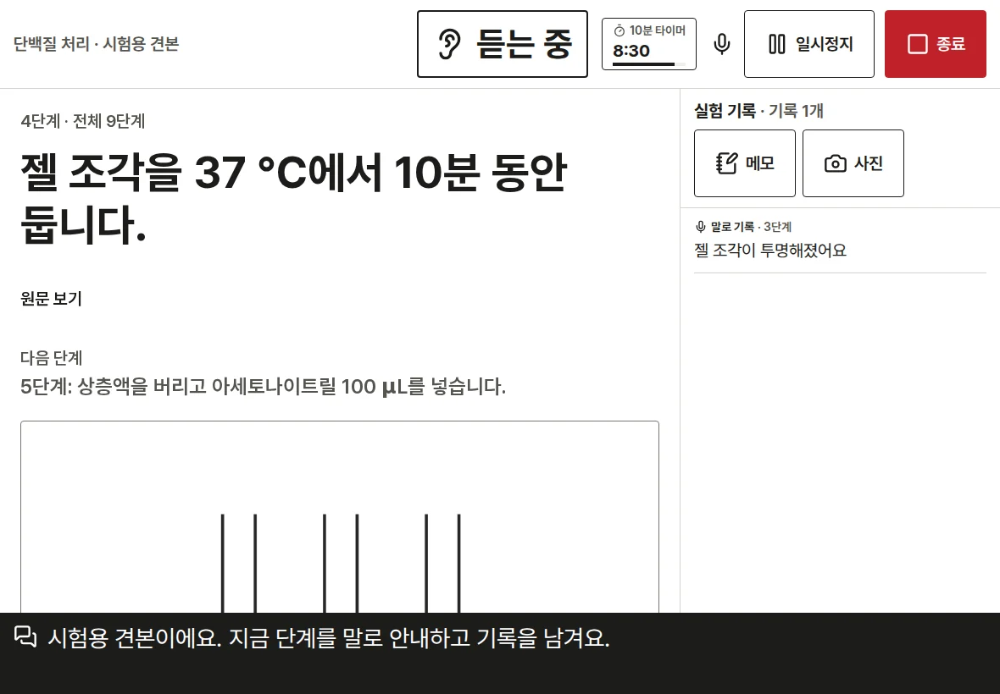

시험용 가짜 자료로 찍은 화면.

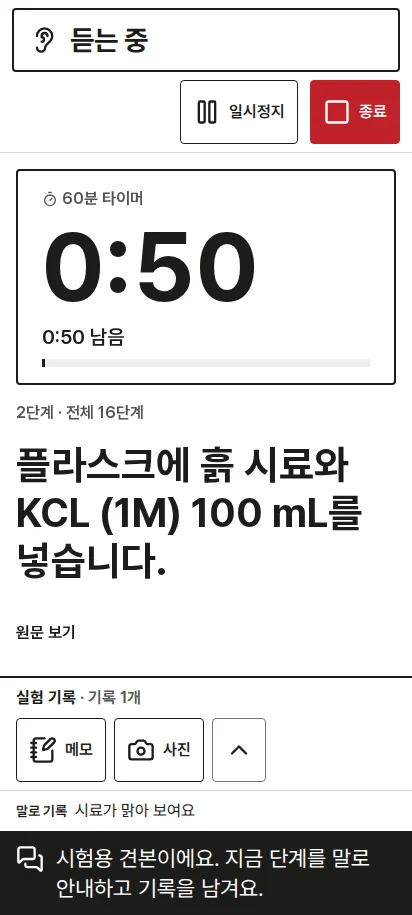

시험용 가짜 자료로 찍은 화면.

### 끝 화면 · 실험 노트

중간에 멈춘 견본 실험이에요. 모든 단계를 완료했다고 표시하지 않아요.

| 가로 태블릿 · 바이오 견본 | 휴대폰 · 화학 견본 |
|---|---|
| 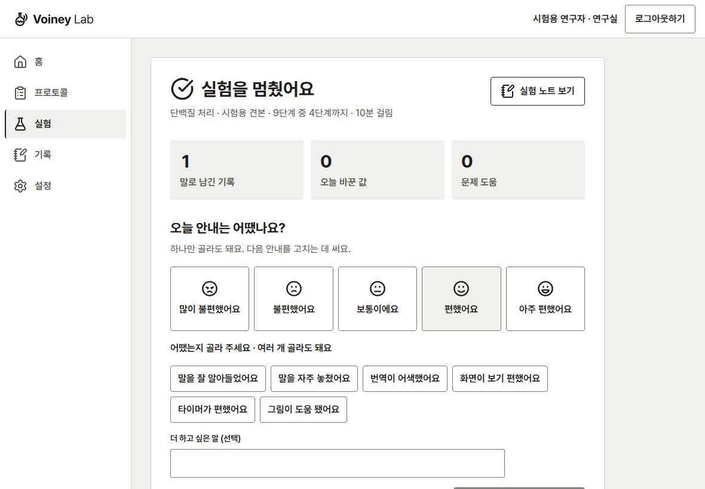 | 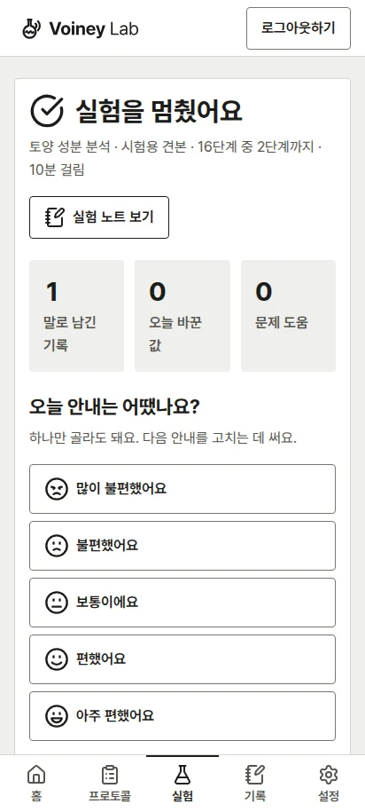 |
| 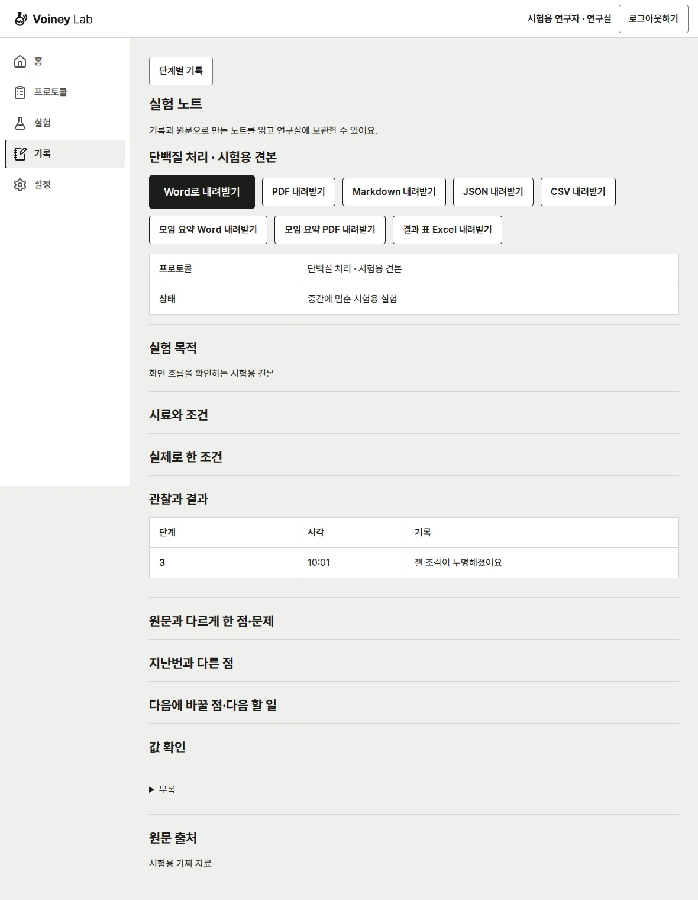 | 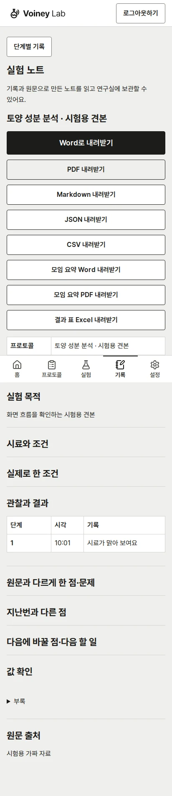 |

시험용 가짜 자료로 찍은 화면.

</details>

촬영 조건과 다시 찍는 명령은 [화면 자료 안내](docs/assets/readme/README.md)에 있어요. API·음성 사건은 가짜 응답이며 외부 공급자를 호출하지 않았어요(contract-tested).

## 3. 실제 음성 시연 영상 — 준비 중

> 실제 음성 시연 영상 — 준비 중

<!-- 사람이 실제로 촬영한 뒤 넣어요.
1. 비공개 자료·계정·키가 보이지 않는 실제 음성 시연 영상을 준비해요.
2. GitHub 이슈/PR 편집기에 영상을 끌어 올린 뒤 생긴 영상 링크를 복사하거나, YouTube에 영상을 올려 공유 링크를 복사해요.
3. 위 인용문을 [실제 음성 시연 영상 보기](영상 링크)로 바꿔요. 촬영일·기기·실제 음성 및 서버 조건을 함께 적어요.
4. GitHub README에서 링크와 재생을 사람이 확인해요. 화면 GIF를 음성 시연 영상으로 대신 표시하지 않아요.
-->

## 4. 작동 방식

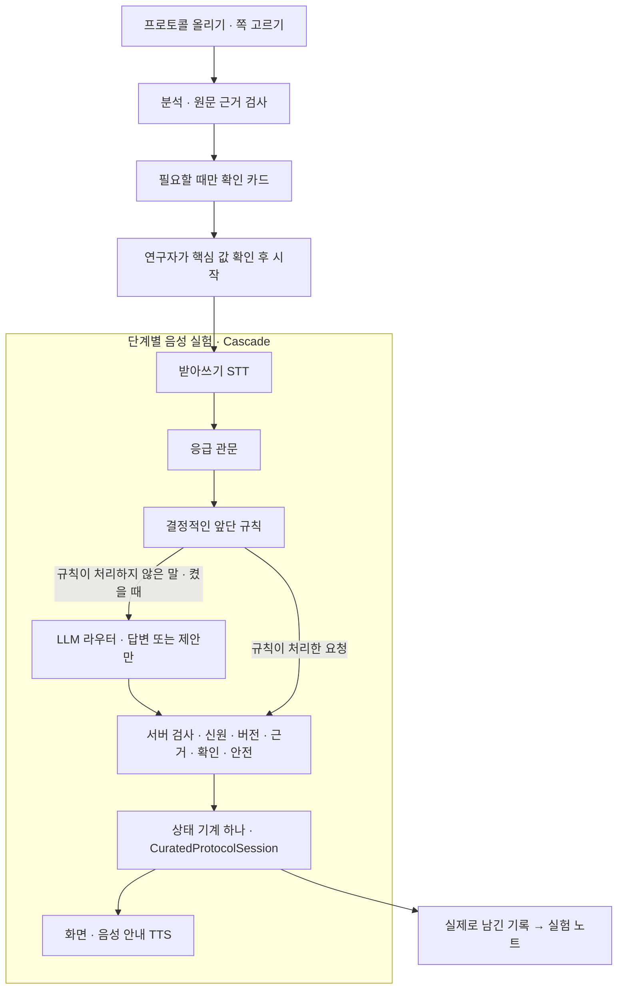

**모델의 답변이 단계를 직접 바꾸지 않아요.** 서버 검사 뒤 한 상태 기계가 단계·타이머·기록을 바꿔요. 응급으로 인식한 말은 고정 안내로 처리하고, 읽기 전용 질문은 실험 진행을 그대로 둬요.

라우터는 기본 꺼짐이에요. 꺼져 있거나 모델이 늦거나 실패하면 같은 턴의 규칙 경로를 쓰며, HTTP 429는 대체 처리 없이 그 턴을 멈춰요. 분석이 통과하고 시작을 막는 문제가 없어야 시작할 수 있어요. 깊은 구조는 [아키텍처](.agent/architecture.md), 기능별 동작은 [FEATURES](docs/FEATURES.md)를 보세요.

## 5. 개발용으로 실행하기

Python **3.12 이상**, 새 화면 빌드에는 **Node.js 22 이상**이 필요해요.

```bash
python -m venv .venv
source .venv/bin/activate
python -m pip install -e '.[test]'
cp .env.example .env
# .env에 모델 역할과 STT·TTS 공급자 설정을 채워요. 키와 .env는 커밋하지 않아요.
./scripts/run_dev.sh --check-only
./scripts/run_dev.sh
```

브라우저에서 **http://127.0.0.1:8000/app/** 을 열어요. 실행기가 새 화면을 빌드해요. 모든 모델 역할과 STT·TTS 설정은 [공급자 설정](docs/FEATURES.md#f17-공급자와-설정), 전체 이름은 [설정 표](src/voiney_lab/setting_names.py)를 따르세요. 빠진 설정은 그 이름을 알리고 해당 기능을 멈춰요.

- 외부 라이선스의 개발용 원문 PDF가 없으면 경고와 함께 빈 프로토콜 목록으로 시작해요. 자기 원문을 올려 주세요.
- 기관 안전 문서 없이 개발할 때는 `VOINEY_LAB_USAGE_SCOPE=source_protocol_only`를 써요. 원문의 안전 주의만 보여 줘요.
- Word 변환·보고서 PDF에는 LibreOffice와 한국어 글꼴이 필요해요. 설치와 선택형 HEIC 지원은 [원문 형식](docs/SOURCE_FORMATS.md), 서버 설치는 [운영 안내](docs/DEPLOYMENT_RUNBOOK.md)에 있어요.
- 기본 로그인 모드는 개발용 한 사람 신원이에요. 초대 계정·HTTPS·파일럿 실행은 [파일럿 안내](docs/PILOT_GUIDE.md)를 따르세요. 휴대폰 마이크는 HTTPS가 필요해요.

## 6. 문서 지도

| 알고 싶은 것 | 문서 |
|---|---|
| 화면 사용법 | [연구자 안내](docs/USER_GUIDE.md) |
| 구현된 기능과 한계 | [FEATURES](docs/FEATURES.md) |
| 제품·사용자·근거 / 다음 계획 | [제품 맥락](.agent/product_context.md) · [로드맵](.agent/roadmap.md) |
| 구조 / 결정과 이유 | [아키텍처](.agent/architecture.md) · [결정 기록](docs/DECISIONS.md) |
| 화면 설계 / 용어 | [UI_SPEC](docs/UI_SPEC.md) · [용어 사전](docs/GLOSSARY.md) |
| 파일럿 / 운영 / 문제 해결 | [파일럿](docs/PILOT_GUIDE.md) · [운영](docs/DEPLOYMENT_RUNBOOK.md) · [문제 해결](docs/TROUBLESHOOTING_GUIDE.md) |
| 전체 문서 목록 | [문서 지도](docs/DOCUMENTATION_INDEX.md) |
| 코드를 고치기 전 | **[AGENTS.md](AGENTS.md)** · [Git 작업 규칙](docs/GIT_WORKFLOW.md) |

## 7. 측정한 것과 아직 모르는 것

숫자는 측정일과 조건이 붙은 기록이에요. **오프라인 통과 수와 합성 시험 점수는 실제 실험실 성능을 뜻하지 않아요.**

| 측정 | 결과 | 날짜 · 조건 · 근거 |
|---|---|---|
| 전체 pytest · 조건 A | **5695 passed · 7 skipped · 2 xfailed · 실패 0** | 2026-10-27, dev `689fb0d`, 외부 라이선스 PDF가 있는 원래 작업 폴더 실측. `after_merge_1027c.log` 기록 |
| 전체 pytest · 조건 B | **5190 passed · 514 skipped · 2 xfailed · 실패 0** | 2026-10-27, dev `689fb0d`, Python 3.12, 라이선스 PDF 없는 CI. [QUAL1의 기준 측정 기록](https://github.com/jaeiko/voiney-lab/pull/148) |
| SIM · 개발용 | **519/540 · 이해 96.11% · 잘못 바뀐 상태 0건** | 2026-10-28, QUAL1 `42437af`, 공개 프로토콜 10종, 저장 번역, 규칙 경로 |
| SIM · 분리된 시험용 | **276/332 · 이해 83.13% · 잘못 바뀐 상태 0건** | 같은 날·커밋·조건. 개발용과 겹치지 않는 고정 분할. [측정 기록](https://github.com/jaeiko/voiney-lab/pull/148) |

조건 A는 라이선스 PDF가 있는 환경, B는 없는 환경이에요. 작업 폴더마다 원문 보유 수가 달라 통과 수가 달라질 수 있어요([정의](AGENTS.md#verification)). SIM은 **정답 글자 STT·가짜 VAD/TTS**를 쓰는 오프라인 동작 시험이에요. 이해 점수는 기대한 동작·확인·상태 보존을 충족한 비율이며, 실제 받아쓰기 정확도나 답변의 과학적 정확도가 아니에요. 방법과 한계는 [합성 음성 시험대](docs/EVALUATION_SIM.md)에 있어요.

실험실 소음 속 받아쓰기, 실제 음성 지연, 장갑을 낀 현장 사용성, 실험 시간 절감은 아직 확인하지 않았어요. 다음 근거는 통제된 파일럿에서 모을 예정이에요.

개발 검증 명령은 다음과 같아요. 여러 작업 폴더가 같은 머신을 쓸 때 전체 pytest는 [공유 잠금 규칙](AGENTS.md)을 따르세요.

```bash
python scripts/replay_turns.py
VOINEY_LAB_MOSS_ENABLED=false \
VOINEY_LAB_WORKSPACE_ENABLED=false \
VOINEY_LAB_EXPERIMENT_REPORTS_ENABLED=false \
VOINEY_LAB_LLM_ROUTER_ENABLED=false \
python -m pytest -q
python -m compileall -q src tests scripts
git diff --check
```

공급자 시험은 가짜 전송을 써요(contract-tested). 실제 공급자 호출이나 현장 시험을 했다는 뜻이 아니에요.

## 8. 라이선스 · 서드파티 고지

저장소 전체의 `LICENSE`와 통합 서드파티 `NOTICE` 파일은 아직 없어요. 배포·재사용 조건은 Voiney에 확인해 주세요. 현재 의존성과 라이선스 메모는 [pyproject.toml](pyproject.toml), 원문·HEIC 조건은 [SOURCE_FORMATS](docs/SOURCE_FORMATS.md), 공개 지식의 출처·라이선스 규칙은 [PUBLIC_KNOWLEDGE](docs/PUBLIC_KNOWLEDGE.md)에 있어요.

- **PyMuPDF**: AGPL-3.0 또는 상용 라이선스이며 [PDF 엔진 경계](src/voiney_lab/pdf_text_engine.py) 한 곳에서만 사용해요. 상용화 전에 상용 라이선스 구매 또는 엔진 교체가 필요해요. 기존 결정 문구: *PyMuPDF is used under its AGPL-3.0 / commercial dual licence; before commercialisation a commercial PyMuPDF licence is bought or the engine is replaced behind that one module.*
- **Moss**: PolyForm Shield 1.0.0이며 OSI 오픈소스 라이선스가 아니에요. 사본에 고지를 함께 두는 조건 등은 [공개 지식 안내](docs/PUBLIC_KNOWLEDGE.md)를 보세요.
- **HEIC**: 선택 설치인 pillow-heif 바이너리 wheel의 GPLv2 조건은 [형식별 안내](docs/SOURCE_FORMATS.md)에 있어요.
- 외부 라이선스의 in-gel 원본 PDF는 커밋하지 않아요. 이 README의 화면은 시험용 가짜 자료예요.

이 저장소는 [voice-ai-course](https://github.com/jaeiko/voice-ai-course)에서 시작했어요.

## English summary

**Voiney Lab**, by **Voiney**, is a hands-free voice guide for chemistry and biology wet labs. Researchers upload their own protocol, check source-linked confirmation cards, start the run, and use step guidance, timers and records to build a lab notebook.

The server owns workflow state; models only propose. **Preparing for a controlled pilot; not yet validated in a working laboratory.** Screenshots use synthetic test data. Offline test scores do not measure real speech or field performance. This is not an ELN/LIMS, an autonomous experimentation system, or a claim of regulatory compliance.
