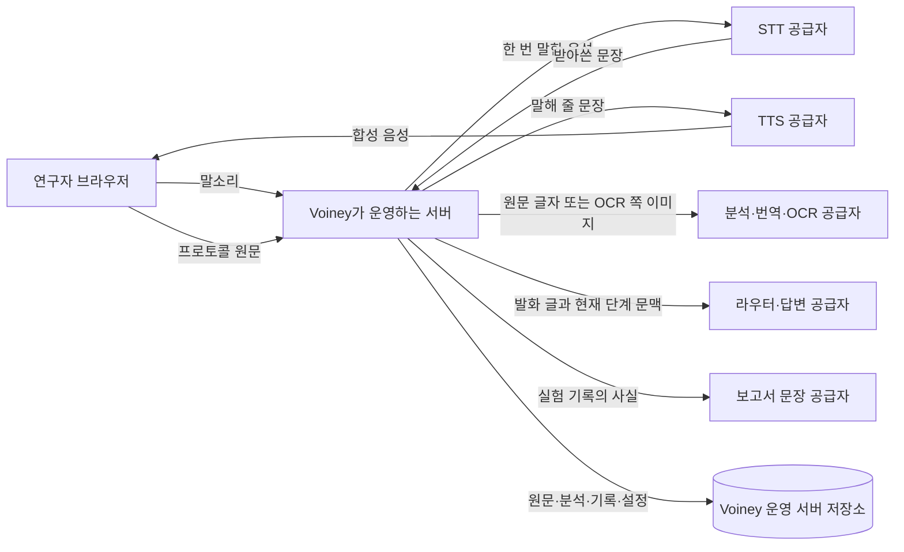

# PI를 위한 Voiney Lab 데이터 흐름

이 문서는 **현재 코드가 어떤 데이터를 어디로 보내고, Voiney가 운영하는 서버에 무엇을 남기는지**를
비전공 PI가 한 번에 확인하기 위한 표다. Voiney Lab은 서버가 단계와 기록을 결정하고,
외부 모델은 답이나 변경을 제안할 뿐이다. `.env.example` 값은 배포 예시이며 코드의
자동 기본값이 아니다. 실제 개발 서버 값과 공급자 약관은 공개 저장소에 노출하지 않도록
아래 두 칸을 의도적으로 비워 둔다. 운영자는 공개 저장소 밖의 자문·배포 기록에서 확인한다.

## 무엇이 밖으로 가는가

| 흐름 | 공급자 역할과 설정 이름 | `.env.example` 예시 | 개발 서버 실제 값 | 보관·학습 사용 약관 확인 |
|---|---|---|---|---|
| 서버 호스팅(사업자·지역) | Voiney 운영 서버의 호스팅 사업자·처리 지역(배포 정보, 코드 설정 없음) | 해당 없음(배포 환경에서 정함) | __________________ | __________________ |
| 말소리 → 받아쓰기 | STT: `VOINEY_LAB_STT_PROVIDER`, `VOINEY_LAB_STT_MODEL`; Google V2이면 `VOINEY_LAB_GOOGLE_STT_V2_LOCATION`, `VOINEY_LAB_GOOGLE_STT_V2_ADAPTATION_ENABLED` | `elevenlabs` · `scribe_v2`; Google V2 지역 `us`, 인라인 힌트 `false` | __________________ | __________________ |
| 문장 → 목소리 | TTS: `VOINEY_LAB_TTS_PROVIDER`, `VOINEY_LAB_TTS_MODEL`, `VOINEY_LAB_TTS_VOICE` | `google_cloud` · 모델/목소리 빈칸(공급자 기본 목소리) | __________________ | __________________ |
| 원문 → 구조 분석 | Analysis: `VOINEY_LAB_ANALYSIS_PROVIDER`, `VOINEY_LAB_ANALYSIS_MODEL` | `google` · `gemini-3.8-flash` | __________________ | __________________ |
| 원문 문장 → 한국어 번역 | Translation: `VOINEY_LAB_TRANSLATION_PROVIDER`, `VOINEY_LAB_TRANSLATION_MODEL` | `google` · `gemini-3.8-flash` | __________________ | __________________ |
| 글자 층 없는 쪽 → 글자 | OCR: `VOINEY_LAB_OCR_PROVIDERS` | 빈칸(설정했을 때만 `clova`/`google`) | __________________ | __________________ |
| 발화 글 + 현재 단계 문맥 → 라우팅 제안 | Router: `VOINEY_LAB_ROUTER_PROVIDER`, `VOINEY_LAB_ROUTER_MODEL` | `openai` · `gpt-6-luna`; `VOINEY_LAB_LLM_ROUTER_ENABLED=false` | __________________ | __________________ |
| 질문 + 근거 문맥 → 읽기 전용 답 | Answer: `VOINEY_LAB_ANSWER_PROVIDER`, `VOINEY_LAB_ANSWER_MODEL` | `openai` · `gpt-6-luna`; `VOINEY_LAB_MULTI_BRAIN_ENABLED=false` | __________________ | __________________ |
| 실험 기록의 사실 → 보고서 문장 | Report: `VOINEY_LAB_REPORT_PROVIDER`, `VOINEY_LAB_REPORT_MODEL` | `google` · `gemini-3.8-flash` | __________________ | __________________ |

빈 역할은 다른 공급자로 자동 전환되지 않고 설정 이름을 밝힌 오류로 닫힌다. 라우터·답변처럼
기능이 꺼진 역할은 설정값이 적혀 있어도 호출하지 않는다. 공개 Google 링크를 가져오면 파일
주소와 다운로드 요청은 Google로 간다. 웹 설명·AI 도식·PDF 밖 보조 설명을 켜면 그 요청과
문맥도 설정한 공급자로 나가지만 `.env.example`에서는 모두 꺼져 있다. 공급자의 보관 기간,
학습 사용, 삭제 요청 방법은 이 저장소가 보증하지 않는다. **파일럿 전에 사람이 각 공급자의
당시 약관과 계약을 공개 저장소 밖에서 확인한다. 개발 서버 실제 값과 약관 확인 칸은 이 공개
문서에서 계속 비워 둔다.**

Google V2를 고르면 지역 설정과 같은 `us` 또는 `eu` 다중 지역 endpoint와 recognition
resource로 한 번 말한 음성이 나간다. 기본 `us`는 바꾸지 않았다. 2026-10-29 같은 한국어
WAV의 실제 요청 3회는 `us` 힌트 404·3,573 ms, `eu` 힌트 404·5,021 ms, `us` 힌트 없음
200·3글자·3,915 ms였다. 그래서 인라인 힌트는 기본 false이며, 지역을 바꾸어 해결됐다고
보지 않는다. 이 endpoint 선택만으로 공급자의 보관·학습 정책이나 법적 데이터 거주를
Voiney Lab이 보증하지 않는다. 그 두 칸은 파일럿 당시 계약을 사람이 별도로 확인한다.
STT 공급자가 힌트를 받는 경우 한 번 말한 음성과 함께 고정된 한국어 명령어, 해당 protocol
revision의 저장 번역 용어집에 있는 한국어 이름, 원문의 기술용어가 최대 100개 나간다.
번역 문장 전체나 실험 기록은 힌트로 새로 만들지 않는다. Google V2는 위 설정이 false인
동안 이 힌트 묶음을 보내지 않는다.

새 올리기 화면은 **"이 원문은 공개되었거나 시판 제품에 딸린 프로토콜인가요?"**를
`예·아니요·모름`으로 묻고 출처 메모를 함께 남긴다. 예시 설정
`VOINEY_LAB_PUBLIC_SOURCE_ONLY=false`는 이 답으로 업로드를 막지 않는다. 운영자가 `true`로
바꾸면 새 파일·프로토콜 링크는 `예`만 파일 저장·링크 가져오기 전에 받는다. 이 답은 올린
사람의 자기 신고이며 공개 여부·권리·라이선스·PI 승인 검증이나 실행 승인 단계가 아니다.
공개·시판 원문만 받더라도 실험 중 말한 관찰과 바꾼 값은 받아쓰기를 위해 STT 공급자로
나가며, 보고서 문장을 만들 때는 기록에 담긴 사실이 보고서 공급자로 나간다.

## Voiney가 운영하는 서버에 남는 것

Voiney가 운영하는 파일럿 서버는 아래를 `data/runtime/pilot/` 아래에 모은다. Voiney가
운영하는 개발 서버는 별도 런타임 폴더를 쓴다.

| 남는 데이터 | 위치 |
|---|---|
| 업로드 원문 PDF | `objects/sha256/…` |
| 분석·OCR·검토 카드·프로토콜 리비전·공개/시판 원문 답과 출처 메모 | `protocol_workspace.sqlite` |
| 관찰·문제·메모와 보고서 문장 | `experiment_reports.sqlite` |
| 실험 세션·번역 문장·실험자 설정 | `workspace/commercial_workspace.sqlite` |
| 사진 같은 증거 파일 | `workspace/evidence/…` |
| 내용 없는 운영 지표(숫자·코드·시각)와 평점 메모 | `workspace/pilot_metrics.sqlite` |
| 계정·비밀번호 해시·세션·로그인 시도(계정 모드) | `workspace/accounts.sqlite` |

일반 음성 사용에서는 원음을 디스크에 저장하지 않는다. 다만
`VOINEY_LAB_STT_DIAGNOSTICS_ENABLED=true`이면 `stt-diagnostics/`에 한 발화의 WAV와
받아쓰기 전·후 문장 및 허용된 진단 항목을 담은 JSON이 남는다. 예시 상한은
`VOINEY_LAB_STT_DIAGNOSTIC_MAX_FILES=20`이며 오래된 WAV·JSON 쌍부터 지운다. 연구자와
별도로 합의하지 않았다면 켜지 않는다.

## 남기지 않는 것과 지우는 법

- 서버 로그와 지표에는 말 내용, 원음, 프로토콜 내용, 모델 추론을 넣지 않는다. API 키와
  `.env`, 원음, 사적 원문 PDF, 받아쓰기, 사용자 식별자, 런타임 DB는 Git에 올리지 않는다.
- 브라우저가 받은 답 음성의 다시 듣기 버퍼와 서버의 TTS 캐시는 메모리에만 있는 한정
  캐시다. 비밀번호 원문은 저장하지 않고 해시만 저장한다.
- 파일럿 전체 삭제는 서버를 멈춘 뒤 `python scripts/pilot_data_delete.py`로 미리보고,
  도구가 출력한 `--delete --confirm <확인 단어>`를 실행한다. 한 계정 삭제는
  `--account <이름>`을 더하지만 연구실 공용 프로토콜은 남는다.
- 삭제 도구는 `deletion_log.jsonl`에 내용·파일명·사용자 식별자 없이 범주·개수·크기·시각과
  결과만 덧붙인다. 백업, 내보낸 보고서, 외부 공급자 보관분, 브라우저 캐시, 디스크 조각은
  자동으로 지우지 않으므로 사람이 별도로 처리한다. 기관 안전 문서도 참가자 데이터가
  아니어서 이 도구의 삭제 대상이 아니다.

PI 확인: **어떤 원문까지 외부 처리해도 되는가? 공개되었거나 시판 제품에 딸린 원문만 받는
파일럿이면 충분한가?** 실제 운영 전에 공급자·보관/학습 약관·진단 녹음 여부·삭제 책임자를
공개 저장소 밖의 운영 기록에 확정하며, 이 표의 개발 서버 실제 값과 약관 칸은 비워 둔다.
자세한 운영 절차는 `docs/PILOT_GUIDE.md`, 실행 코드 기준은
`docs/FEATURES.md` F2·F17·F18, L1–L3 내부 처리 설계는 `docs/CONFIDENTIAL_MODE.md`를 따른다.
